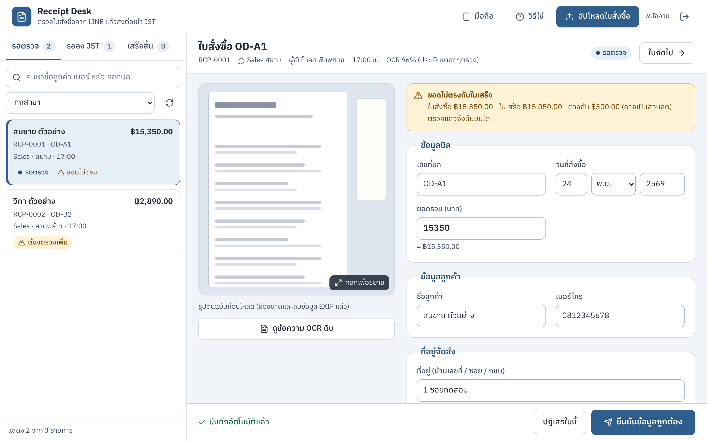

# Receipt Desk

ระบบตรวจใบสั่งซื้อสำหรับ Sale ออฟฟิศ: อัปโหลดรูปใบสั่งซื้อ → ระบบอ่านข้อมูลด้วย OCR → คนตรวจและแก้ → ยืนยัน → ลงใน JST (ตอนนี้ลงเอง แล้วกดทำเครื่องหมายในระบบ)



## ภาพรวมการทำงาน

```
เบราว์เซอร์ (React)  ⇄  /api/*  (Vite ตอน dev · Vercel Function ตอนใช้งานจริง)  ⇄  Supabase (Auth · Postgres · Storage)
                                    └─→ OCR (Gemini / Typhoon) — คีย์อยู่ฝั่งเซิร์ฟเวอร์เท่านั้น
```

- เบราว์เซอร์ไม่คุยกับฐานข้อมูลโดยตรง และไม่มีคีย์ใด ๆ — ล็อกอินแล้วได้คุกกี้ HttpOnly
- API ใช้ **สิทธิ์ของผู้ใช้ที่ล็อกอิน** ติดต่อ Supabase (ไม่ใช้คีย์ service role) และฐานข้อมูลตรวจสิทธิ์ซ้ำด้วย RLS: ใช้ได้เฉพาะคนที่อยู่ในตาราง `receipt_users` และเปิดใช้งานอยู่
- ตารางทั้งหมดขึ้นต้นด้วย `receipt_` (SQL อยู่ใน `db/` — รันตามลำดับ `receipt_desk_schema_v1.sql`, `receipt_desk_access_v1.sql`, `receipt_desk_delete_v1.sql`)

## สถานะใบสั่งซื้อ

รอตรวจ / ต้องตรวจเพิ่ม → **ยืนยันแล้ว (รอลง JST)** → **ลง JST แล้ว** · หรือ **ปฏิเสธ** (ต้องมีเหตุผล)
ใบที่ดึงมาผิด/อัปโหลดผิดรูป **ลบได้เฉพาะตอนที่ยังรอตรวจ** (ปุ่มถังขยะในรายการ ต้องยืนยันก่อน) — แถวและรูปถูกลบ แต่เหตุการณ์ `deleted` ยังอยู่ใน `receipt_events` พร้อมรหัสใบ/เลขที่บิล/ชื่อลูกค้า
ยืนยันแล้วข้อมูลถูกล็อก ย้อนกลับไปแก้ได้จนกว่าจะทำเครื่องหมายว่าลง JST แล้ว ฐานข้อมูลบังคับกติกา (ข้อมูลครบ เบอร์โทร 10 หลัก รหัสไปรษณีย์ 5 หลัก ฯลฯ) ไม่พึ่งแค่หน้าเว็บ ทุกการกระทำถูกบันทึกใน `receipt_events` (แก้/ลบไม่ได้)

## ตั้งค่าครั้งแรก

1. **สร้างผู้ใช้** ที่ Supabase → Authentication → Users → Add user (อีเมล + รหัสผ่าน)
2. **เพิ่มในรายชื่อที่ใช้ระบบได้** (รันใน SQL Editor ทีละคน — คนที่ไม่อยู่ในรายชื่อ แม้มีบัญชีในโปรเจกต์เดียวกันก็เข้าไม่ได้):

   ```sql
   insert into public.receipt_users (user_id, email, display_name, role)
   select id, email, 'ชื่อที่แสดง', 'admin' from auth.users where email = 'staff@example.com';
   ```

3. **ตั้งค่า `.env`** (คัดลอกจาก `.env.example`; ไฟล์นี้ไม่ถูก commit):

   | ตัวแปร | ความหมาย |
   |---|---|
   | `SUPABASE_URL` | URL ของโปรเจกต์ (Settings → API) |
   | `SUPABASE_ANON_KEY` | publishable (anon) key — เป็นคีย์สาธารณะ ใช้ร่วมกับ token ของผู้ใช้เท่านั้น |
   | `OCR_PROVIDER` | `gemini` / `typhoon` — ไม่ตั้ง = ไม่ใช้ OCR (เก็บรูปแล้วกรอกเอง) |
   | `GEMINI_API_KEY`, `GEMINI_MODEL`, `GEMINI_FALLBACK_MODEL` | ดู `.env.example` |
   | `TYPHOON_API_KEY` | ถ้าใช้ Typhoon |
   | `RECEIPT_BRANCHES` | รายชื่อสาขา คั่นด้วยจุลภาค (ค่าเริ่มต้น สยาม,ลาดพร้าว,บางนา,รังสิต) |

4. ตรวจคีย์ OCR: `npm run check-keys`

## รันบนเครื่อง

Node.js 20.19+ หรือ 22.12+

```sh
npm ci
npm run dev
```

เปิด http://localhost:5173 แล้วเข้าสู่ระบบ

## ขึ้นระบบจริง (Vercel)

- `api/index.js` คือ Vercel Function เดียวที่รับทุกเส้นทาง `/api/*` (ผ่าน rewrite ใน `vercel.json`) ใช้ตรรกะเดียวกับตอน dev; `vercel.json` ตั้งเวลารันสูงสุด 60 วินาที (การอ่านรูปอาจนาน — เช็กว่าแผนของคุณรองรับ) และเพิ่ม security headers
- ตั้ง environment variables ตามตารางด้านบนใน Vercel (อย่าตั้ง `OCR_ALLOW_MOCK`) แล้ว deploy
- คุกกี้ใช้ `Secure` อัตโนมัติเมื่ออยู่หลัง https
- ขนาดรูปที่ส่งต้องไม่เกินประมาณ 4.5MB (ขีดจำกัดของ Vercel) — เบราว์เซอร์ย่อรูปให้อยู่ในเกณฑ์แล้ว

## OCR

- ผู้ให้บริการสลับได้ด้วย `OCR_PROVIDER` — โค้ดใน `server/ocr/` (Gemini ใช้ JSON schema, Typhoon อ่านข้อความแล้วดึงฟิลด์)
- แปลงวันที่ พ.ศ./ค.ศ. เบอร์โทร ยอดเงินในโค้ด ความมั่นใจประเมินจากกฎตรวจ ไม่ใช้ค่าที่โมเดลบอก ช่องที่ไม่แน่ใจถูกไฮไลต์เหลือง
- ถ้า OCR ล้มเหลวหรือยังไม่ได้ตั้งค่า ระบบยังเก็บรูปและสร้างใบให้กรอกเอง (ไม่ค้าง)
- ตรวจใบซ้ำ: เลขที่บิลและยอดตรงกับใบเดิม
- **ชั้นฟรีของ Gemini/Typhoon อาจนำข้อมูลไปพัฒนาผลิตภัณฑ์** ใบสั่งซื้อมีข้อมูลลูกค้า (ความเสี่ยงที่เจ้าของโปรเจกต์รับไว้ — ดู Decision Log ใน Notion) ส่งเฉพาะรูป ลบ EXIF แล้ว
- โค้ด Gemini/Typhoon ทดสอบด้วย fetch จำลองเท่านั้น ยังไม่เคยเรียก API จริงในการพัฒนา
- เปรียบเทียบผู้ให้บริการ: `node --env-file=.env scripts/ocr-bakeoff.js <โฟลเดอร์รูป> --providers=gemini,typhoon` (รูปคู่กับ `ชื่อ.expected.json` พิมพ์เฉพาะคะแนน ไม่พิมพ์ข้อมูลลูกค้า อย่า commit รูปจริง)

## ความปลอดภัยและข้อมูลส่วนบุคคล

- ใบสั่งซื้อมีชื่อ เบอร์โทร ที่อยู่ลูกค้า — ตาราง/รูปอ่านได้เฉพาะเจ้าหน้าที่ในรายชื่อ (RLS) รูปอยู่ใน bucket แบบ private เข้าผ่านลิงก์ชั่วคราว (1 ชั่วโมง)
- โปรเจกต์ Supabase นี้ใช้ร่วมกับระบบอื่นของทีม และภูมิภาคอยู่ที่โซล — ควรให้ผู้รับผิดชอบ PDPA รับทราบ และกำหนดอายุเก็บข้อมูล
- ยังไม่มี: การกู้คืนรหัสผ่านในหน้าเว็บ (ใช้แดชบอร์ด Supabase), อายุเก็บ/ลบข้อมูลอัตโนมัติ, หน้าจัดการผู้ใช้

## ทดสอบ

```sh
npx playwright install chromium
npm test
```

ถ้ามี Chromium อยู่แล้ว ใช้ `PLAYWRIGHT_CHROMIUM_EXECUTABLE_PATH=/usr/bin/chromium npm test`

- เทสต์ไม่แตะ Supabase หรือ OCR จริง: ใช้ Supabase จำลอง (`tests/helpers/`) ผ่านตัวจัดเส้นทาง API จริงของเรา
- `tests/api.unit.spec.js` — ล็อกอิน/สิทธิ์/CSRF/อัปโหลด/แก้ไข/ยืนยัน/ปฏิเสธ/ล็อก/กันแก้ทับ
- `tests/ocr.unit.spec.js` — แปลงวันที่/เบอร์/ยอด, การตอบกลับของ Gemini และ Typhoon (fetch จำลอง)
- `tests/receipts.spec.js` — หน้าเว็บทั้งขั้นตอน รวมมือถือและขนาดตัวอักษร
- ทดสอบ RLS ในฐานข้อมูลจริงทำด้วย SQL แบบย้อนกลับ (ผลบันทึกไว้ใน Notion) ยังไม่มีเทสต์อัตโนมัติกับ Supabase จริง
